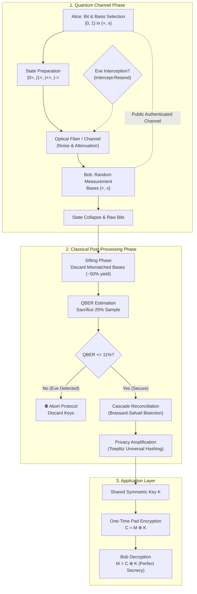

# ⚛️ Quantum Key Distribution (QKD) Simulation & Cryptography Suite

[](LICENSE)
[](.github/workflows/ci.yml)
[](package.json)
[](run_simulation.py)
[-purple.svg)](#supported-protocols)

A production-grade, mathematically rigorous **Quantum Key Distribution (QKD)** research and simulation framework. Implements **BB84** (four-state conjugate polarization), **E91** (Ekert entanglement with CHSH Bell Inequality violation), **Cascade error reconciliation**, **Toeplitz universal hash privacy amplification**, and **information-theoretically secure One-Time Pad (OTP)** messaging.

Includes dual native implementations (**Node.js** and **Python 3**) with zero required external dependencies, plus an interactive **Web Laboratory Visualizer**.

---

## 🔬 Theoretical Foundations

### 1. Quantum Physics Principles
- **No-Cloning Theorem**: An unknown arbitrary quantum state $|\psi\rangle$ cannot be duplicated. Any eavesdropper (Eve) attempting to measure photons inevitably perturbs their quantum state.
- **Conjugate Bases**: In BB84, measuring in the rectilinear basis ($+$: $|0\rangle, |1\rangle$) vs the diagonal basis ($\times$: $|+\rangle, |-\rangle$) introduces Heisenberg uncertainty. If Eve measures in the wrong basis, she collapses the qubit and produces a detectable 25% error rate on sifted bits.
- **Quantum Entanglement & CHSH Inequality (E91)**: Ekert's protocol uses entangled photon pairs $|\Phi^+\rangle = \frac{|00\rangle + |11\rangle}{\sqrt{2}}$. The Clauser-Horne-Shimony-Holt (CHSH) parameter $S$ satisfies:
  - Classical local hidden variable bound: $S \le 2$
  - Quantum entangled maximum (Tsirelson's bound): $S = 2\sqrt{2} \approx 2.8284$
  - Any eavesdropping collapses entanglement, driving $S \le 2$ and immediately exposing Eve.

### 2. Shor-Preskill Security Bound
For BB84 with an intercept-resend attack:
$$\text{QBER} = \frac{\text{Bit Errors}}{\text{Sifted Sample}}$$
If $\text{QBER} > 11.0\%$, the mutual information between Alice and Bob drops below Eve's information:
$$I(A; B) < I(A; E)$$
The protocol automatically **aborts transmission**, discarding all compromised keys.

---

## 🏗️ Architecture & Pipeline Flow



---

## 📁 Repository Structure

```
.
├── src/                          # Node.js Core Implementation
│   ├── core/
│   │   ├── basis.js              # Rectilinear (+) & Diagonal (x) bases
│   │   ├── qubit.js              # Hilbert space state vectors & Born rule
│   │   └── channel.js            # Depolarizing noise, fiber loss & channel
│   ├── attacks/
│   │   └── eve.js                # Intercept-resend attack & eavesdropper
│   ├── postprocessing/
│   │   ├── sifting.js            # Classical basis reconciliation
│   │   ├── qber.js               # QBER calculation & entropy bounds
│   │   ├── cascade.js            # Cascade error reconciliation (bisection)
│   │   └── privacy.js            # Universal Toeplitz matrix hashing
│   ├── protocols/
│   │   ├── bb84.js               # BB84 end-to-end coordinator
│   │   └── e91.js                # Ekert 91 CHSH entanglement simulator
│   ├── crypto/
│   │   └── otp.js                # One-Time Pad & AES-256-GCM
│   ├── cli.js                    # Rich colored terminal interface
│   └── index.js                  # Package entrypoint
├── qkd/                          # Python 3 Core Implementation
│   ├── core/                     # Basis, Qubit, Channel
│   ├── attacks/                  # Eve interception
│   ├── postprocessing/           # Sifting, QBER, Cascade, Privacy
│   ├── protocols/                # BB84 & E91
│   └── crypto/                   # One-Time Pad
├── web/                          # Interactive Web Simulator
│   ├── index.html                # Dark-mode quantum laboratory UI
│   └── serve.js                  # Zero-dependency local dashboard server
├── tests/
│   ├── node/                     # Node.js native test runner suites
│   └── python/                   # Python unittest test suites
├── .github/workflows/ci.yml      # Automated GitHub Actions test pipeline
├── run_simulation.py             # Python standalone CLI runner
├── package.json                  # Node project config & scripts
├── pyproject.toml                # Python packaging standard
└── requirements.txt              # Optional Python extras
```

---

## 🚀 Quick Start

### 1. Prerequisites
- **Node.js**: Version 18+ (tested on Node v20 & v24)
- **Python**: Version 3.8+ (optional, standard library only)

### 2. Running Simulations (Node.js)

**Standard BB84 Simulation (Secure Channel):**
```bash
npm start
# or
node src/cli.js --qubits 1200 --noise 0.015 --eve 0.0
```

**Simulate Eavesdropper Detection (Eve Active):**
```bash
npm run simulate:eve
# or
node src/cli.js --qubits 1200 --eve 0.35
```
*Result: Eve intercepts 35% of qubits, raising QBER to ~13%. The protocol automatically detects the intrusion and aborts!*

**Run Ekert 91 Entanglement & CHSH Bell Test:**
```bash
npm run simulate:e91
# or
node src/cli.js --protocol e91 --qubits 3000
```
*Result: Evaluates CHSH parameter $S \approx 2.8284 > 2.0$, confirming genuine quantum non-locality.*

### 3. Running Automated Tests
```bash
npm test
```
*Runs 9 end-to-end test suites verifying QBER thresholding, Cascade error correction, Bell inequality violations, and One-Time Pad cryptography.*

### 4. Running with Python
```bash
python run_simulation.py
```
To run Python unit tests:
```bash
python -m unittest discover tests/python
```

### 5. Interactive Web Dashboard
Launch the visual quantum laboratory:
```bash
npm run web
```
Then navigate to `http://localhost:3000` in your browser. You can adjust qubit counts, Eve interception sliders, noise levels, and watch photons fly across the quantum channel in real time!

---

## 📊 Sample Output (BB84 Terminal Run)

```text
======================================================================
  ⚛️  QUANTUM KEY DISTRIBUTION (QKD) SIMULATION SUITE  ⚛️
  Information-Theoretic Security Powered by Quantum Mechanics
======================================================================

Running BB84 Protocol Simulation...
  • Qubits Transmitted:   1200
  • Channel Noise Rate:   1.5%
  • Eve Intercept Rate:   0.0% (NO EAVESDROPPER)

[1] Classical Sifting Phase:
  • Raw Sifted Bits:      626 (52.2% basis match)

[2] QBER Estimation & Security Check:
  • Sample Size Revealed: 157 bits
  • Measured QBER:        0.00% (Threshold: 11.0%)
  • Channel Status:       ✓ SECURE CHANNEL - PROCEED

[3] Cascade Error Reconciliation:
  • Parity Checks:        107
  • Errors Corrected:     4
  • Key Reconciled:       ✓ 100% BIT MATCH

[4] Privacy Amplification (Toeplitz Hashing):
  • Final Key Length:     442 bits (55 bytes)
  • Key Checksum (Hex):   98e6156b0b180448c7d67b3c36494b41...
  • Alice & Bob Match:    ✓ IDENTICAL KEYS

[5] Cryptographic Application (One-Time Pad):
  • Plaintext:            "QKD::TOP_SECRET_ALPHA"
  • Ciphertext (Hex):     c9ad5151314c4b1898853e7f640c1f1e580a13c975
  • Bob Decrypted:        "QKD::TOP_SECRET_ALPHA"
  • Verification:         ✓ PERFECT DECRYPTION

✨ Simulation completed successfully! ✨
```

---

## 🌐 Pushing to GitHub

To publish this project to your GitHub account:

### Step 1: Initialize Git & Commit (if not already done)
```bash
git init
git add .
git commit -m "feat: initial Quantum Key Distribution (QKD) framework"
```

### Step 2: Create a Repository on GitHub
1. Go to [GitHub - Create a New Repository](https://github.com/new).
2. Repository name: `quantum-key-distribution` (or your preferred name).
3. Choose **Public** or **Private**.
4. Leave "Add a README" **unchecked** (we already have a complete one).
5. Click **Create repository**.

### Step 3: Link Remote and Push
```bash
git remote add origin https://github.com/<YOUR_GITHUB_USERNAME>/quantum-key-distribution.git
git branch -M main
git push -u origin main
```

*(Or use GitHub CLI if installed)*:
```bash
gh repo create quantum-key-distribution --public --source=. --remote=origin --push
```

---

## 📜 License
This project is open-source under the [MIT License](LICENSE).

